# Жизненный цикл заявки

Основано на фреймах доски Figma «Хакатон Альфа-Будущее'26»: «Статусная модель кредитной заявки» (18 этапов, 4 решения андеррайтера, 2 терминальных статуса), «Кредитная политика» и «Пользовательский путь · Получение кредита». Где фреймы расходятся, приоритет у пользовательского пути — это самая свежая и упрощённая версия.

Переходы зашиты в `backend/app/services/status_machine.py` — это единственное место, где они определены. Любое изменение статуса проходит через `ensure_transition` и пишется в `application_status_history`.

```mermaid
stateDiagram-v2
    [*] --> draft
    draft --> data_collection: клиент дал согласия
    data_collection --> pre_approved: ИИ рассчитал предварительный лимит
    pre_approved --> submitted: клиент продолжает
    pre_approved --> closed: клиент отказался

    submitted --> ai_verification
    ai_verification --> ai_financial_analysis: данных достаточно
    ai_verification --> need_additional_data: не хватает данных
    need_additional_data --> ai_verification: документы досланы (дозапрос ИИ)
    need_additional_data --> underwriter_review: документы досланы (дозапрос андеррайтера)
    ai_financial_analysis --> ai_risk_scoring
    ai_risk_scoring --> need_additional_data: повторный запрос документов
    ai_risk_scoring --> decision_routing

    decision_routing --> underwriter_review: зелёная зона
    decision_routing --> analyst_escalation: жёлтая зона
    decision_routing --> closed: красная зона - автоотказ
    analyst_escalation --> analyst_completed: заключение аналитика
    analyst_completed --> underwriter_review

    underwriter_review --> offer_generated: approved / conditional_approval (контр-предложение)
    underwriter_review --> need_additional_data: нужны документы клиента
    underwriter_review --> analyst_escalation: нужна экспертиза аналитика
    underwriter_review --> closed: declined

    offer_generated --> offer_accepted: клиент принял
    offer_generated --> offer_rejected: клиент отказался
    offer_rejected --> closed
    offer_accepted --> contract_generation
    contract_generation --> e_sign
    e_sign --> disbursement: клиент подписал (симуляция)
    disbursement --> completed: средства перечислены (симуляция)

    completed --> [*]
    closed --> [*]
```

## Статусы

| # | Статус | Этап | Кто двигает дальше |
|---|---|---|---|
| 1 | `draft` | Черновик: клиент открыл раздел кредитования | Клиент (согласия) |
| 2 | `data_collection` | ИИ собирает данные: ФНС, БКИ, ЕГРЮЛ/ЕГРИП, обороты РКО, цифровой профиль | Система |
| 3 | `pre_approved` | Предварительный лимит: вероятность одобрения, диапазон суммы, ставка, рекомендации | Клиент |
| 4 | `submitted` | Клиент подтвердил сумму, срок, цель и согласие на проверки | Система |
| 5 | `ai_verification` | Полнота анкеты, подлинность документов, консистентность данных | Система |
| 6 | `need_additional_data` | Единый цикл уточнений: от ИИ или андеррайтера. Анализ начинается только после полного комплекта | Клиент |
| 7 | `ai_financial_analysis` | Выручка, EBITDA, Cash Flow, DSCR, долговая нагрузка, LTV → AI Credit Memo | Система |
| 8 | `ai_risk_scoring` | Стоп-факторы, основания эскалации, скоринг → Risk Grade A–E, зона риска, оффер или контр-предложение ИИ | Система |
| 9 | `decision_routing` | Маршрут по зоне: зелёная — андеррайтеру, жёлтая — аналитику, красная — автоотказ | Система |
| 10 | `analyst_escalation` | Кредитный аналитик подтверждает или корректирует вывод ИИ; сюда же — запрос экспертизы от андеррайтера | Аналитик |
| 11 | `analyst_completed` | Заключение аналитика добавлено в Credit Memo | Система |
| 12 | `underwriter_review` | Андеррайтер получает AI Credit Memo, заключение аналитика или оба и принимает одно из 4 решений | Андеррайтер |
| 13 | `offer_generated` | Оффер: сумма, ставка, срок, график, причины решения | Клиент |
| 14 | `offer_accepted` | Клиент принял оффер | Система |
| 15 | `offer_rejected` | Клиент отказался от оффера | Система |
| 16 | `contract_generation` | Подготовка кредитных документов | Система |
| 17 | `e_sign` | Подписание электронной подписью (симуляция) | Клиент |
| 18 | `disbursement` | Перечисление средств (симуляция) | Система |
| — | `completed` | Терминальный: средства выданы | — |
| — | `closed` | Терминальный: «Закрыто без выдачи» | — |

Причина закрытия — `applications.close_reason`, четыре пути к финалу без выдачи:

| `close_reason` | Откуда |
|---|---|
| `pre_approval_declined` | Клиент отказался после предварительного расчёта (`pre_approved`) |
| `auto_declined` | Красная зона: стоп-фактор (`decision_routing`) |
| `underwriter_declined` | Отказ андеррайтера (`underwriter_review`) |
| `offer_rejected` | Клиент не принял оффер или контр-предложение (`offer_rejected`) |

## Статусы глазами клиента

Клиент не видит внутреннюю работу банка. `ApplicationRead.client_status` считается в `app/services/client_status.py`:

| `client_status` | На доске | Внутренние статусы |
|---|---|---|
| `draft` | — | `draft`, `data_collection`, `pre_approved` |
| `created` | «Заявка создана» | `submitted` |
| `under_review` | «Идет рассмотрение заявки» | `ai_*`, `decision_routing`, `analyst_*`, `underwriter_review` |
| `documents_required` | — (запрос документов клиенту) | `need_additional_data` |
| `approved` / `counter_offer` | «Одобрено» / «Контр-предложение» | `offer_generated` … `e_sign`, по типу решения андеррайтера |
| `signed` | «Подписано» | `disbursement` |
| `disbursed` | «Средства зачислены» | `completed` |
| `closed` | «Закрыто» | `offer_rejected`, `closed` |

## Решения андеррайтера (`credit_decisions.decision_type`)

| Решение | Переход |
|---|---|
| `approved` | → `offer_generated` |
| `conditional_approval` | → `offer_generated`: контр-предложение, изменены сумма, срок, ставка или обеспечение. Клиент видит «Банк готов предоставить финансирование на измененных условиях» |
| `more_information_required` + `more_info_target=client` | → `need_additional_data`: ИИ-агент формирует дозапрос документов; после ответа — сразу обратно в `underwriter_review` |
| `more_information_required` + `more_info_target=credit_analyst` | → `analyst_escalation`: аналитик проводит экспертизу и обновляет заключение → `underwriter_review` |
| `declined` | → `closed` |

## Кредитный конвейер

Реализован в `backend/app/services/pipeline.py`. Запускается сразу после команды клиента, в том же запросе. Каждый прогон — одна транзакция: при сбое заявка остаётся на исходном этапе (`data_collection` или `submitted`), а команда клиента сохранена.

1. **После согласий** (`data_collection → pre_approved`):
   - сбор данных из внешних источников (`enrichment`);
   - признаки, скоринг и кредитная политика на запрошенных условиях;
   - предварительный расчёт (`pre_approvals`).

   Вероятность одобрения берётся по Risk Grade: A 0,9 … E 0,25. В жёлтой зоне она ×0,8, в красной — 0,05.

   Сумма до — рекомендованная политикой, ставка — с учётом риск-надбавки. В рекомендациях — сценарии контр-предложения, основания эскалации или стоп-факторы.
2. **После подачи:**
   - `ai_verification`: данные собираются заново. Если нет выручки и EBITDA ни из ФНС, ни из анкеты, создаётся системный дозапрос отчётности и заявка уходит в `need_additional_data`;
   - `ai_financial_analysis → ai_risk_scoring`: в `scoring_results` пишутся DSCR, Debt Burden и LTV на запрошенных условиях, балл, Risk Grade, зона, confidence, fraud_score, факторы, стоп-факторы и основания эскалации; в `credit_memos` — AI Credit Memo с рекомендацией, условиями и корректировками контр-предложения;
   - `decision_routing`: зелёная зона → `underwriter_review`, жёлтая → `analyst_escalation`, красная → `closed` (`auto_declined`, причина в комментарии истории).

**Источники данных для политики.**
- Выручка и EBITDA — из отчётности ФНС, иначе из анкеты.
- Действующие платежи — из отчётности, иначе `monthly_debt_payments × 12`.
- Залог — из заявки.

`confidence` из скоринга передаётся в политику: ниже 0,8 — эскалация. Если не ответил хотя бы один внешний источник, это тоже эскалация (`missing_external_data`).

**Скоринг** — `services/scoring.py`, реализация выбирается `SCORING_MODEL`.
- Контракт `ScoringModel`: признаки `Features.values` и контекст (профиль заёмщика и заявка в формате контракта ML) на входе; `score` 300–900, `risk_grade` A–E, `confidence`, `fraud_score` и `factors` на выходе.
- `ml` (по умолчанию в Docker) — сервис `ml/service` поверх `ml/scoring`: калиброванная вероятность дефолта CatBoost и SHAP-факторы.
  - Вероятность переводится в грейд по порогам A ≤ 3%, B ≤ 6%, C ≤ 12%, D ≤ 25%, иначе E.
  - Балл — кусочно-линейно по тем же границам (3% ↔ 800, 6% ↔ 720, 12% ↔ 650, 25% ↔ 580), так что балл и грейд согласованы.
  - `confidence` и `fraud_score` считаются по полноте и противоречивости данных: модель их не отдаёт.
  - Если сервис недоступен или не ответил источник данных, используется `rules` (в `model_version` — пометка).
- `rules` — объяснимая модель на правилах.
- Модель обучена на синтетических метках дефолта — это демонстрация, а не проверенная вероятность дефолта.

## Договор и выдача (симуляция)

Реализовано в `backend/app/services/loans.py` и `schedule.py`. Подписание и выдача смоделированы, как требует кейс.

1. **Принятие оффера** (`offer_accepted → contract_generation → e_sign`): создаётся кредитный договор (`loan_contracts`, номер `КД-2026-000045`) в статусе `awaiting_signature`.
   - Условия — неизменяемый снимок принятого решения андеррайтера.
   - Сразу формируется график платежей (`payment_schedule_items`) с плановыми датами: клиент видит его до подписания.
2. **Подписание** (`e_sign → disbursement`): симуляция электронной подписи (`signature_id`), договор переходит в `signed`.
3. **Выдача** (`disbursement → completed`):
   - открывается ссудный счёт `45207810…`;
   - сумма зачисляется на расчётный счёт клиента из профиля (`bank_account`), фиксируется идентификатор проводки;
   - график пересчитывается от фактической даты выдачи;
   - договор переходит в `active`.

**Финальные статусы:**

| Сущность | Успех | Без выдачи |
|---|---|---|
| Заявка (`applications.status`) | `completed` — средства выданы | `closed` с `close_reason`: `pre_approval_declined`, `auto_declined`, `underwriter_declined`, `offer_rejected` |
| Клиенту (`client_status`) | `disbursed` («Средства зачислены») | `closed` («Закрыто») |
| Кредит (`loan_contracts.status`) | `awaiting_signature` → `signed` → `active`; далее `overdue`, `closed` (обслуживание кредита не моделируется) | договор не создаётся |

**График платежей** — упрощение проекта:
- аннуитет; платёж совпадает с «ориентировочным платежом» в оффере;
- проценты за месяц = остаток × годовая ставка / 12, без учёта числа дней;
- платежи в тот же день месяца, что и выдача; 31-е в коротком месяце — последний день месяца;
- последний платёж закрывает остаток до копейки.

Остаток долга и ближайший платёж считаются из графика и не хранятся.

**Идемпотентность:**
- Договор и ссудный счёт уникальны на заявку (ограничения в БД).
- Повторные `offer/accept` и `sign` возвращают текущее состояние, данные не меняют.
- Если выдача не прошла (например, у клиента нет действующего расчётного счёта — `409`), подпись сохраняется и заявка остаётся в `disbursement` с действием `sign`. Повторный `sign` доводит выдачу.

## Кредитная политика

Реализована в `backend/app/services/credit_policy.py` (чистые функции, пороги — `PolicyThresholds`). Результат — рекомендация ИИ для AI Credit Memo, финальное решение по зелёной и жёлтой зоне всегда за андеррайтером.

Формулы с доски:

- DSCR = EBITDA / Debt Service;
- Debt Burden = Debt Service / EBITDA × 100%;
- Debt Service = годовые платежи по действующим кредитам + годовые платежи (аннуитет) по запрашиваемому;
- LTV = сумма кредита / (рыночная стоимость × (1 − дисконт)) × 100%. Дисконт — верхняя граница диапазона по типу залога: коммерческая недвижимость 0,3, жилая 0,25, транспорт 0,5, оборудование 0,6, товар в обороте 0,7.

Порядок оценки:

1. **Стоп-факторы → красная зона, автоотказ** (`decision_routing → closed`, `close_reason=auto_declined`). Клиенту объясняется причина.
   - Юридические: банкротство или наблюдение, блокировка счетов по 115-ФЗ, собственники в санкционных списках, запрещённая деятельность.
   - Финансовые: Cash Flow < 0 более 3 месяцев подряд, DSCR < 0,9.
   - Признаки фиктивности: массовый адрес, массовый директор, нет сотрудников, нет налоговой активности.
2. **Основания эскалации → жёлтая зона, кредитный аналитик**: уверенность модели < 80%, бизнес младше 12 месяцев, конфликтующие данные, LTV ≥ 70%, слабая кредитная история. Аномалия или неуверенность ИИ — не отказ.
3. **Контр-предложение ИИ**: сценарии применяются по порядку, каждый возвращает в зелёную зону с новыми условиями (`credit_memos.counter_offer_adjustments`):

| # | Сценарий | Условие | Что меняется |
|---|---|---|---|
| 1 | `auto_approval_limit` | Сумма больше лимита автоодобрения | Сумма = меньшая из величин: 5 млн ₽ и 20% годового оборота |
| 2 | `term_extension` | DSCR < 1,1 | Срок увеличивается (до максимума продукта), пока DSCR ≥ 1,1 |
| 3 | `debt_burden_amount_reduction` | Debt Burden ≥ 50% | Сумма уменьшается до Debt Burden ≤ 50% |
| 4 | `ltv_amount_reduction` | LTV ≥ 70% | Сумма уменьшается до LTV ≤ 70%; добавить залог или гарантию Корпорации МСП предлагает аналитик |
| 5 | `risk_premium` | Падение выручки 20–30% или слабая кредитная история | Сумма сохраняется, ставка + риск-надбавка (1–3%, по умолчанию 2%) |

**Альтернативные варианты при пограничном риске** (`credit_memos.alternative_offers`).

Сценарии идут по порядку, поэтому могут урезать сумму там, где клиенту хватило бы более длинного срока. Сценарий 2 продлевает срок только до DSCR ≥ 1,1, а потом сценарий 3 снижает сумму под Debt Burden ≤ 50%.

Поэтому, если запрошенные условия не проходят зелёную зону, рядом с основным контр-предложением считаются варианты. Каждый проходит все пороги: лимит, DSCR, Debt Burden, LTV. Ставка во всех вариантах одна, с учётом риск-надбавки.

| `kind` | Вариант |
|---|---|
| `longer_term` | Сумма сохраняется (в пределах лимита и LTV), срок — минимальный проходящий, но больше запрошенного |
| `lower_amount` | Срок как в заявке, сумма — максимальная проходящая |
| `max_term` | Максимальный срок продукта и наибольшая сумма на нём (меньше платёж или больше сумма) |

Где используются варианты:
- **Предварительный расчёт:** варианты попадают в рекомендации клиенту, а `amount_max` — лучший из основного и альтернативных.
- **Контр-предложение андеррайтера:** он выбирает вариант по коду `alternative_offer` в `conditional_approval`. Сумма, срок и ставка берутся из Credit Memo; явно переданные поля имеют приоритет.

4. **Зелёная зона** — сумма в лимите, DSCR ≥ 1,1, Debt Burden ≤ 50%, LTV ≤ 70%, нет стоп-факторов и эскалаций → андеррайтеру. Без корректировок рекомендация `approve` (запрошенная сумма, базовая ставка), с корректировками — `counter_offer`.

Матрица решений: все показатели хорошие → автоодобрение (рекомендация), небольшие отклонения → контр-предложение, недостаточно данных → запрос документов, стоп-фактор → отказ, аномалия → эскалация аналитику.

## Допущения и неопределённости

- Отказ клиента на `pre_approved` → `closed`: на статусной модели не определён, но на пользовательском пути ведёт в «Закрыто без выдачи».
- Возвраты из `need_additional_data` взяты с пользовательского пути: после дозапроса ИИ — повторная проверка комплекта (`ai_verification`), после дозапроса андеррайтера — сразу `underwriter_review`. Статусная модель предлагала возврат в финансовый анализ.
- Отдельного автоматического закрытия по fraud больше нет: признаки фиктивного бизнеса — стоп-фактор, автоотказ на `decision_routing`. `fraud_score` остаётся метрикой скоринга.
- Отмена заявки клиентом на других этапах на доске не предусмотрена — не реализуется.
- Лимит автоодобрения: в условии зелёной зоны «до 5 млн ИЛИ ≤ 20% оборота», в контр-предложении — «меньшая из величин». Реализована меньшая из величин.
- Минимальный DSCR: в политике 1,1, в статусной модели 1,2. Принят 1,1 из политики.
- Debt Burden = 1 / DSCR, поэтому порог 50% равен DSCR ≥ 2 и фактически строже порога DSCR. Требует подтверждения формулы или порога.
- Не описано на доске, принято эскалацией аналитику: падение выручки > 30% (`severe_revenue_drop`); контр-предложение не выводит показатели в зелёную зону (`no_counter_offer`) — например, действующие платежи уже больше 50% EBITDA или срок упёрся в максимум продукта.
- Риск-надбавка: на доске 1–3%, по умолчанию 2%.
