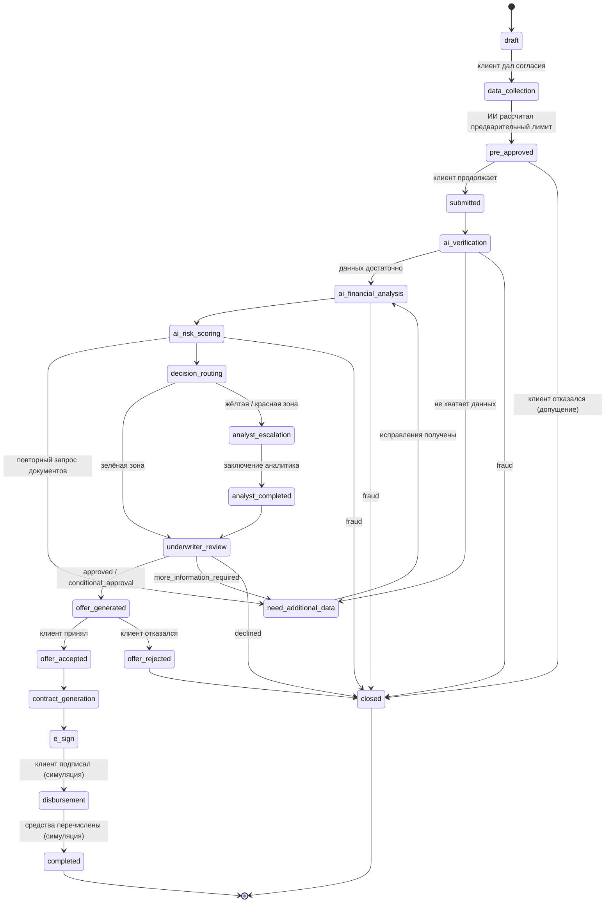

# Жизненный цикл заявки

Основано на статусной модели и карте кредитной политики (доска Figma «Хакатон Альфа-Будущее'26»): 18 этапов, 4 решения андеррайтера, 2 терминальных статуса.

Переходы зашиты в `backend/app/services/status_machine.py` — это единственное место, где они определены. Любое изменение статуса проходит через `ensure_transition` и пишется в `application_status_history`.

## Статусы

| # | Статус | Этап | Кто двигает дальше |
|---|---|---|---|
| 1 | `draft` | Черновик: клиент открыл раздел кредитования | Клиент (согласия) |
| 2 | `data_collection` | ИИ собирает данные: ФНС, БКИ, ЕГРЮЛ/ЕГРИП, обороты РКО, цифровой профиль | Система |
| 3 | `pre_approved` | Предварительный лимит: вероятность одобрения, диапазон суммы, ставка, рекомендации | Клиент |
| 4 | `submitted` | Клиент подтвердил сумму, срок, цель и согласие на проверки | Система |
| 5 | `ai_verification` | Полнота анкеты, подлинность документов, консистентность данных | Система |
| 6 | `need_additional_data` | Единый цикл уточнений: от ИИ или андеррайтера | Клиент |
| 7 | `ai_financial_analysis` | Выручка, EBITDA, Cash Flow, DSCR, долговая нагрузка, сезонность → AI Credit Memo | Система |
| 8 | `ai_risk_scoring` | Правила, скоринг, риск-модели → Risk Grade A–E, зона риска | Система |
| 9 | `decision_routing` | Маршрут по зоне и уверенности. Автоотказа здесь нет | Система |
| 10 | `analyst_escalation` | Кредитный аналитик подтверждает или корректирует вывод ИИ | Аналитик |
| 11 | `analyst_completed` | Заключение аналитика добавлено в Credit Memo | Система |
| 12 | `underwriter_review` | Андеррайтер принимает одно из 4 решений | Андеррайтер |
| 13 | `offer_generated` | Оффер: сумма, ставка, срок, график, причины решения | Клиент |
| 14 | `offer_accepted` | Клиент принял оффер | Система |
| 15 | `offer_rejected` | Клиент отказался от оффера | Система |
| 16 | `contract_generation` | Подготовка кредитных документов | Система |
| 17 | `e_sign` | Подписание электронной подписью (симуляция) | Клиент |
| 18 | `disbursement` | Перечисление средств (симуляция) | Система |
| — | `completed` | Терминальный: средства выданы | — |
| — | `closed` | Терминальный: отказ банка, отказ клиента от оффера, fraud | — |

Причина закрытия хранится в `applications.close_reason`.

## Решения андеррайтера (`credit_decisions.decision_type`)

| Решение | Переход |
|---|---|
| `approved` | → `offer_generated` |
| `conditional_approval` | → `offer_generated` с изменёнными условиями (меньше сумма/срок, залог, поручительство, гарантия Корпорации МСП) |
| `more_information_required` | → `need_additional_data`, создаётся дозапрос |
| `declined` | → `closed` |

## Правила маршрутизации (из кредитной политики)

| Зона | DSCR | Debt Burden | LTV | Маршрут |
|---|---|---|---|---|
| Зелёная | ≥ 1,2 | < 50% | ≤ 70% | Андеррайтер |
| Жёлтая | 1,0–1,2 | 50–70% | 70–85% | Кредитный аналитик |
| Красная | < 1,0 или есть стоп-факторы | > 70% | > 85% | Кредитный аналитик |

Обязательная эскалация аналитику при любом основании (хранятся в `scoring_results.escalation_reasons`): уверенность модели < 80%, сумма > 10 млн ₽, новый клиент без кредитной истории, бизнес < 1 года, необычная отрасль, конфликтующие данные, подозрение на дробление бизнеса, сложная структура владения.

Стоп-факторы (`scoring_results.stop_factors`) дают рекомендацию отказа в Credit Memo, но финальное решение — за андеррайтером. Единственное автоматическое закрытие — высокий fraud-риск (`fraud_score > threshold`).

## Допущения и неопределённости

- Финал отказа клиента на `pre_approved` на доске не определён — принято `closed`.
- Отмена заявки клиентом на других этапах на доске не предусмотрена — не реализуется.
- Числовые пороги, не заданные в политике (порог рейтинга, `FRAUD_SCORE threshold`, лимит исполнительных производств, минимальный DSCR после выдачи), задаются конфигурацией и требуют согласования.
