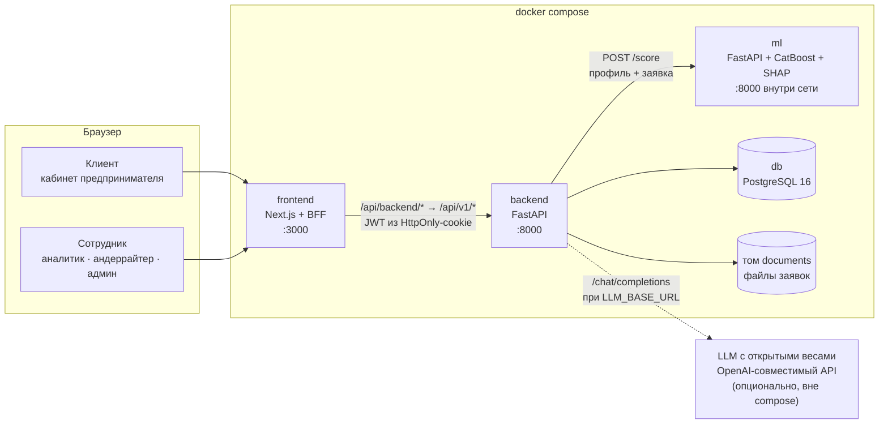
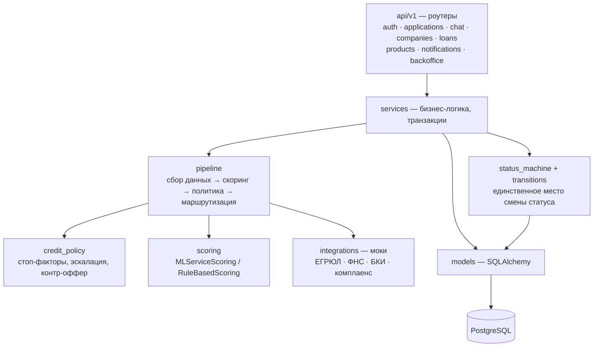
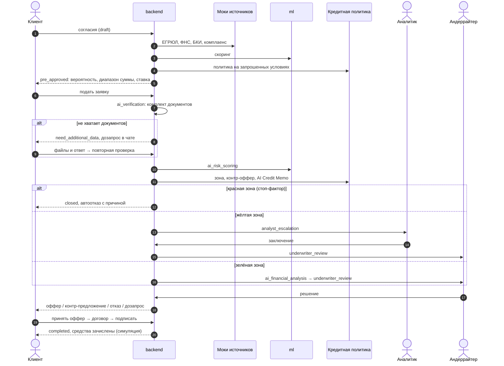

# Архитектура

Прототип цифрового кредитного конвейера для малого и среднего бизнеса. В одном продукте — путь клиента от потребности до выдачи кредита и обработка заявки банком (ИИ-агент, кредитный аналитик, андеррайтер). Всё запускается одной командой `docker compose up --build`. Внешние системы заменены локальными моками, данные синтетические.

## Компоненты

| Сервис | Что делает | Технологии |
|---|---|---|
| `frontend` | Экраны клиента и сотрудников по макетам команды. BFF: вход, хранение JWT в HttpOnly-cookie, прокси к API по списку разрешённых путей, проверка Origin для изменяющих запросов | Next.js 16, React 19, TypeScript |
| `backend` | REST API `/api/v1`, кредитный конвейер, политика, решения, договор и выдача, документы, чат, уведомления. Миграции и демо-данные — при старте контейнера | Python 3.12, FastAPI, Pydantic v2, SQLAlchemy 2.1 async, Alembic |
| `ml` | Инференс скоринга: калиброванная вероятность дефолта и объясняющие факторы SHAP. Модель обучается при сборке образа на синтетических данных | CatBoost, scikit-learn, SHAP |
| `db` | Заявки, решения, история статусов, документы (метаданные), чат, уведомления | PostgreSQL 16 |
| том `documents` | Файлы, загруженные клиентами | локальная ФС |
| LLM (опционально) | Формулирует ответы ИИ-агента в чате по фактам из backend | Ollama / llama.cpp / vLLM, Qwen2.5 и др. |

Зависимости запуска: frontend ждёт healthy backend, backend — healthy db и ml. Если ml недоступен, скоринг считается встроенными правилами; без LLM агент отвечает по шаблонам. Демо-сценарий не зависит ни от ML, ни от LLM.

## Backend

- **Слои.** Роутер проверяет роль и схему запроса, сервис выполняет команду в одной транзакции и сам делает `commit`. Ошибки домена (`NotFoundError`, `ForbiddenError`, `ConflictError`, `ValidationFailedError`) превращаются в 404 / 403 / 409 / 422 в `main.py`.
- **Статусы.** Переходы описаны таблицей в `services/status_machine.py`: для каждой пары «из → в» указано, кто вправе её выполнить (клиент, система, аналитик, андеррайтер). Статус меняет только `transitions.transition()`: она проверяет переход, пишет историю, ставит даты этапов, назначает исполнителя (`assignment.py`) и сообщает клиенту в чат и в уведомления (`chat_events.py`, `notifications.py`).
- **Команды вместо PATCH статуса.** `/submit`, `/offer/accept`, `/sign`, `/cancel`, `/decision` и т. п. Клиенту в ответе приходит `available_actions` — по нему фронт строит кнопки.
- **Оптимистичная блокировка.** Редактирование заявки — с `version`, команды берут строку `SELECT … FOR UPDATE`.
- **Деньги** — `numeric(15,2)`, в API строкой. Enum'ы в БД — `varchar + CHECK`.

## Кредитный конвейер

Прогоны конвейера идут синхронно сразу после команды клиента, каждый — одна транзакция: при сбое заявка остаётся на прежнем этапе. Финальное решение по зелёной и жёлтой зоне всегда за андеррайтером. Подробно — [`application-lifecycle.md`](application-lifecycle.md).

## Данные и интеграции

- **Внешние источники** — модули `app/integrations/`: отвечают в формате Borrower Profile ([`credit_mmb_data_model_updated.md`](credit_mmb_data_model_updated.md)) из датасета ML (`BORROWER_DATASET_PATH`) или из генератора `synthetic.py`. Демо-ИНН воспроизводят стоп-факторы и сценарии — [`external-sources.md`](external-sources.md). Ответы источников сохраняются в `external_checks`.
- **Скоринг.** `MLServiceScoring` отправляет профиль и заявку в `ml`, переводит вероятность дефолта в грейд A–E и балл, факторы SHAP — в объяснения. При ошибке — правила, с пометкой в `model_version`.
- **Документы.** Метаданные — в `documents`, файлы — в `DOCUMENT_STORAGE_DIR`; ключ хранения формирует backend, тип файла проверяется по сигнатуре.
- **Модель данных** — [`data-model.md`](data-model.md), API — [`api/README.md`](api/README.md), OpenAPI — [`api/openapi.yaml`](api/openapi.yaml).

## Безопасность

- **Роли.** Клиент входит по телефону (упрощение кейса: пользователь уже клиент банка), сотрудник — по логину и паролю (PBKDF2). JWT HS256, секрет — `JWT_SECRET`.
- **Изоляция данных.** Клиент видит только заявки, документы, чат и профиль компаний, в которых состоит; чужие объекты — 404. Сотрудник видит заявки, назначенные на него или с которыми работал; решения принимает только исполнитель. Админ видит всё.
- **BFF.** Токен не попадает в JavaScript браузера: он лежит в HttpOnly-cookie, запросы к API идут через прокси фронта с проверкой Origin и списка путей.
- **LLM** получает только факты по заявке и не выполняет команд: создание, подача, решения — обычные команды API, которые подтверждает человек.
- **Файлы.** Имя файла клиента в путь хранения не попадает, допустимые форматы и размер ограничены, скачивание — с проверкой доступа.

## Развёртывание

`docker-compose.yml` в корне: четыре сервиса с healthchecks, тома `postgres_data` и `documents`, переменные — в [`.env.example`](../.env.example). Версии образов и зависимостей зафиксированы (lock-файлы, точные теги образов). Проверка с нуля — в README.
