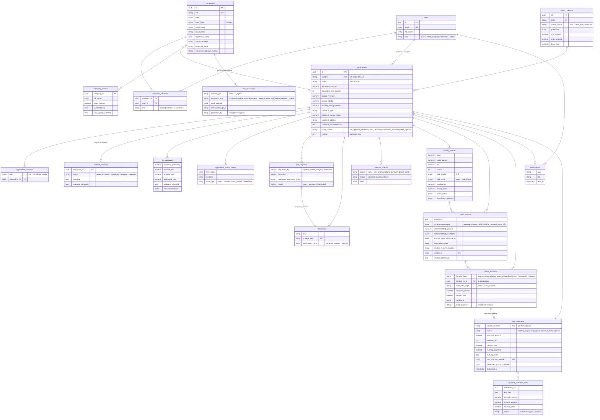

# Модель данных

PostgreSQL 16. Источник правды — ORM-модели в `backend/app/models/`, схема разворачивается миграциями Alembic (`backend/migrations/`).

## Ключевые решения

| Решение | Почему |
|---|---|
| UUID в качестве PK + отдельный человекочитаемый `applications.number` из sequence | UUID не раскрывает объём заявок и безопасен для API; номер нужен клиенту и сотруднику для общения |
| Enum как `varchar + CHECK`, а не нативный `ENUM` Postgres | Добавление статуса/типа не требует `ALTER TYPE` и не блокирует таблицу; целостность сохраняется на уровне БД |
| Деньги — `numeric(15,2)`, в API — строка | Без потерь точности float |
| `scoring_results` → `credit_memos` → `credit_decisions` | По политике рекомендация ИИ отделена от финального решения: скоринг даёт метрики и зону, Credit Memo — рекомендацию ИИ и вывод аналитика, решение всегда за андеррайтером |
| DSCR, Debt Burden, LTV, зона и confidence — отдельные колонки (Debt Burden только аналитический) | По ним работает маршрутизация и фильтрация очереди бэкофиса; остальные метрики — в `metrics` (JSONB) |
| `stop_factors`, `escalation_reasons`, `factors` в JSONB | Объяснимость: андеррайтер видит, почему заявка ушла к аналитику или в автоотказ и что повлияло на оценку |
| `credit_memos.counter_offer_adjustments` | Контр-предложение ИИ по сценариям политики (лимит, срок, LTV, риск-надбавка): что и почему изменилось относительно запроса |
| `credit_memos.analyst_recommendation` отдельно от `ai_recommendation` | Андеррайтер видит и вывод ИИ, и вывод аналитика; скорректированные аналитиком условия пишутся в `recommended_*` |
| `created_at` / `updated_at` ставятся в Python (`server_default` — запасной) | Значение доступно сразу после flush без повторного запроса (в async ленивая загрузка невозможна); переходы одной транзакции упорядочены в истории |
| `info_requests.requested_by` | После ответа клиента заявка возвращается к инициатору дозапроса: ИИ, аналитику или андеррайтеру |
| `documents.verification_status`, файлы вне БД | Проверенный ИИ документ клиент удалить не может; содержимое — в файловом хранилище (`DOCUMENT_STORAGE_DIR`), ключ формирует backend |
| `credit_decisions.more_info_target` | У «нужны данные» два возвратных маршрута: документы от клиента или экспертиза аналитика |
| `applications.close_reason` — enum | Четыре пути к финалу «Закрыто без выдачи» с доски; клиенту показывается причина |
| `collateral_address`, `collateral_encumbrances`, `pre_approvals.collateral_required` | Консультация с залогом уточняет адрес и обременения; предварительный расчёт показывает необходимость обеспечения |
| `collateral_type` + `collateral_market_value` | Дисконт для LTV зависит от типа залога (коммерческая недвижимость 0,2–0,3 … товар в обороте 0,5–0,7) |
| `annual_ebitda` | Входит в DSCR = EBITDA / Debt Service и Debt Burden |
| `application_consents` | Без согласий на БКИ/ФНС/цифровой профиль ИИ не начинает сбор данных (этап Draft) |
| `pre_approvals` | Клиент видит шансы и диапазон до подачи — ключевой запрос персоны «новый заёмщик» |
| `company_owners` | Проверка собственников по санкционным спискам и основание эскалации «сложная структура владения» |
| Сырые ответы внешних источников в `external_checks.result` (JSONB) | Контракты моков могут меняться; сохраняется доказательная база для решения |
| Профиль компании — снимок в `companies` / `company_owners` (`services/companies.sync_company`) | Реквизиты, руководитель и учредители — из (мока) ЕГРЮЛ, контакты и расчётный счёт — данные клиента банка; снимок обновляется при привязке и запуске сида, фактический адрес и число сотрудников от клиента не затираются. `company_owners.has_signing_authority` + `head_has_signing_authority` дают список подписантов |
| `chat_messages` у компании, `application_id` — необязательный | Диалог начинается до заявки (подбор параметров); при создании черновика сообщения без заявки привязываются к нему. Уникальный `(company_id, client_message_id)` защищает от дублей при повторе запроса; `generated_by` показывает, кто сформулировал ответ — шаблоны или LLM |
| `internal_requests` отдельно от `info_requests` | Запрос экспертизы андеррайтера у аналитика — внутренний, клиент его не видит; у него свой цикл (принят, закрыт заключением, возвращён, отозван) и он разделяет вкладки очереди аналитика |
| `users.phone` уникален | Клиент входит по номеру телефона |
| `applications.assignee_id` ставится при входе на этап | Аналитик и андеррайтер работают со своими заявками; назначение — в `services/assignment.py`, вызывается из `transition()` |
| `application_status_history` | Аудит (кто, когда, почему изменил статус) и таймлайн в кабинете клиента |
| `applications.version` | Оптимистичная блокировка: клиент и сотрудники банка не перезаписывают изменения друг друга |
| Файлы — только метаданные в БД, содержимое в объектном хранилище (`storage_key`) | БД не раздувается бинарными данными |
| `loan_contracts` уникален по заявке и по решению андеррайтера | Договор — снимок условий принятого оффера; уникальность делает подготовку договора и выдачу идемпотентными |
| `payment_schedule_items` отдельной таблицей | Строки графика с плановыми и фактическими статусами платежей; остаток и ближайший платёж считаются из них |
| `notifications` | Сценарий по условиям кейса проходит внутри продукта, без email/SMS |
