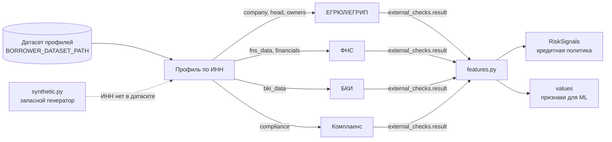

# Внешние источники (моки) и признаки заёмщика

По условиям кейса внешние системы заменены локальными моками на синтетических данных, без сетевых вызовов. Данные заёмщика хранятся в формате **Borrower Profile** из [`credit_mmb_data_model_updated.md`](credit_mmb_data_model_updated.md) (раздел 2 и 8.1). На этот формат согласились команда и генератор ML.

Код:
- `backend/app/integrations/` — формат профиля, загрузка датасета, запасной генератор, моки;
- `backend/app/services/features.py` — признаки;
- `backend/app/services/enrichment.py` — сбор данных по заявке.

## Как устроено

- **Датасет** задаётся переменной `BORROWER_DATASET_PATH`: JSON Lines, JSON-массив или один профиль.
  - Профили проверяются при загрузке (`dataset.BorrowerProfile`): если нет обязательного поля, будет ошибка с его именем.
  - Обязательны блоки, по которым принимаются решения: `company`, `fns_data`, `compliance`, `bki_data`, `financials`. Блоки для экранов (`head`, `owners`, `contacts`, `bank_account`, `documents`) необязательны.
  - Лишние поля сохраняются. Числовые поля сверх формата в `financials` и `bki_data` (например, балансовые показатели ML) автоматически становятся признаками `fin_*` и `bki_*`.
- **ИНН, которого нет в датасете**, генерируется на лету в том же формате (`synthetic.py`). Генерация детерминирована по ИНН: здоровая компания со случайными, но стабильными параметрами. Демо-ИНН включают сценарии политики.
- **`collect_external_data`** опрашивает источники параллельно и сохраняет ответы в `external_checks`. Если источник не ответил, проверка сохраняется со статусом `failed`, сбор не прерывается.
- **`build_features`** собирает признаки из последних успешных ответов. Признаки неответившего источника не подставляются, источник попадает в `missing_sources`. Что делать без него, решает конвейер: заявка уходит аналитику (`missing_external_data`).
- **`GET /companies/lookup?inn=`** предзаполняет реквизиты и учредителей из блоков `company` и `owners`.

Пример профиля, который тест принимает как есть: `backend/tests/fixtures/borrower_profile_example.json` (взят из документа).

## Источники

| Источник (`CheckSource`) | Блоки профиля |
|---|---|
| `egrul` — ЕГРЮЛ/ЕГРИП | `company`, `head`, `owners` |
| `fns` — ФНС | `fns_data`; `financials` — бухотчётность, которую банк получает через ФНС |
| `bki` — БКИ | `bki_data` |
| `compliance` — комплаенс | `compliance`: санкции, запрещённая деятельность |

## Демо-ИНН (запасной генератор)

| ИНН | Сценарий |
|---|---|
| `7701000001` | Здоровая компания, зелёная зона |
| `7701000002` | Действующее банкротство: стоп-фактор |
| `7701000003` | Запрещённая деятельность (азартные игры): стоп-фактор |
| `7701000004` | Нет сотрудников: стоп-фактор |
| `7701000005` | Нет налоговой активности: стоп-фактор |
| `7701000006` | Платежи по кредитам больше EBITDA: DSCR ниже 0,9, стоп-фактор |
| `7701000007` | Бизнесу 7 месяцев: эскалация аналитику |
| `7701000008` | Просрочка в БКИ: слабая кредитная история, эскалация и риск-надбавка |
| `7701000009` | Счёт заблокирован по 115-ФЗ: стоп-фактор |
| `7701000010` | Высокая действующая долговая нагрузка |
| `7701000011` | БКИ не отвечает |
| `7701000012` | Налоговая задолженность |
| `7701000013` | Собственник в санкционных списках: стоп-фактор |
| `7701000014` | Массовый адрес и массовый директор: стоп-фактор |
| `7701000015` | Отрицательный Cash Flow 4 месяца подряд: стоп-фактор |
| `7701000016` | Падение выручки на 25%: риск-надбавка |
| `7701000017` | Процедура наблюдения: стоп-фактор |
| `7701000018` | Пограничный риск: на 5 млн и 24 мес. DSCR ниже 1,1 (но не стоп-фактор), на 29+ мес. проходит — контр-предложение продлением срока и варианты |
| `7701000099` | Компании нет в ЕГРЮЛ |
| `770100000001` | ИП, здоровый бизнес |

## Признаки

### Для кредитной политики (`RiskSignals`)

| Сигнал | Поле профиля |
|---|---|
| Стоп-фактор `bankruptcy` / `observation_procedure` | `fns_data.bankruptcy_status` = `bankruptcy` / `observation` |
| Стоп-фактор `accounts_blocked_115fz` | `fns_data.has_account_block_115fz` |
| Стоп-факторы `mass_address`, `mass_director` | `fns_data.is_mass_address`, `fns_data.is_mass_director` |
| Стоп-фактор `no_tax_activity` | `fns_data.has_tax_activity = false` |
| Стоп-факторы `sanctioned_owner`, `prohibited_activity` | `compliance.sanctions_hit`, `compliance.is_prohibited_activity` |
| Стоп-фактор `no_employees` | `company.employees_count = 0` (есть на доске, в документе не указан) |
| Стоп-фактор `negative_cash_flow` | Самая длинная серия месяцев подряд с отрицательным `financials.cash_flow_last_12m`; больше 3 — стоп-фактор |
| Стоп-фактор `low_dscr` | Считает политика: `financials.ebitda` / (действующие платежи + платёж по новому кредиту) < 0,9 |
| `business_age_months` | `company.registration_date` |
| `weak_credit_history` | `bki_data.credit_history_quality = weak`, или `overdue_amount > 0`, или `max_overdue_days_12m ≥ 30` |
| `revenue_drop` | `−financials.revenue_change_pct / 100`, если выручка падает |
| `conflicting_data` | Расхождение больше 30%: выручка в анкете и `financials.annual_turnover`; платежи по кредитам в анкете и `bki_data.monthly_debt_service` |

`existing_annual_debt_service` = `bki_data.monthly_debt_service × 12` — вход для DSCR.

`model_confidence` — выход ML-модели, его выставляет скоринг.

### Для ML (`Features.values`)

Плоский словарь, значения — числа, строки, bool:

- компания: `legal_form`, `okved_main`, `region_code`, `tax_system`, `business_age_months`, `employees_count`, `owners_count`;
- ФНС: `egrul_status`, `bankruptcy_status`, `blocked_115fz`, `mass_address`, `mass_director`, `has_tax_activity`, `tax_arrears`, `has_tax_debt`;
- комплаенс: `sanctions_hit`, `prohibited_activity`;
- финансы: `fin_annual_turnover`, `fin_ebitda`, `fin_revenue_change_pct`, `fin_cash_flow_12m`, `negative_cash_flow_months`, `ebitda_margin`, `debt_to_ebitda`, `dscr_existing` и любые дополнительные числовые поля `financials` с префиксом `fin_`;
- БКИ: `credit_history_quality`, `bki_active_loans`, `bki_total_debt`, `bki_monthly_debt_service`, `bki_overdue_amount`, `bki_max_overdue_days_12m`, `weak_credit_history` и дополнительные числовые поля с префиксом `bki_`;
- `conflicting_data`.

## Допущения

- Слабая кредитная история: кроме `credit_history_quality = weak`, ещё любая просроченная задолженность или просрочка от 30 дней.
- Конфликт данных — расхождение больше 30%.
- `fns_data.egrul_status` = `liquidating` / `liquidated` пока только признак: в списке стоп-факторов документа такого кода нет.
- Налоговая задолженность — только признак, не стоп-фактор.
