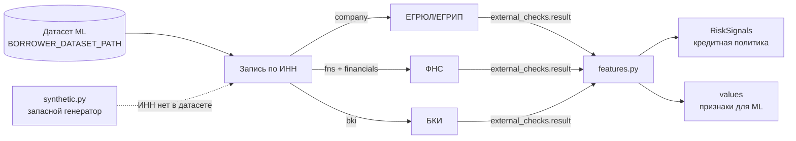

# Внешние источники (моки) и признаки заёмщика

По условиям кейса внешние системы заменены локальными моками на синтетических данных, без сетевых вызовов. Данные идут в формате генератора ML: моки ЕГРЮЛ, ФНС и БКИ отдают блоки его записи по ИНН.

Код:
- `backend/app/integrations/` — формат записи, загрузка датасета, запасной генератор, моки;
- `backend/app/services/features.py` — признаки;
- `backend/app/services/enrichment.py` — сбор данных по заявке.

## Как устроено

- **Датасет ML** задаётся переменной `BORROWER_DATASET_PATH`: JSON Lines, JSON-массив или одна запись. Записи проверяются при загрузке (`dataset.BorrowerRecord`). Если нет обязательного поля, будет ошибка с его именем. Лишние поля сохраняются. Если по ИНН несколько срезов, берётся самый свежий `as_of_date`.
- **ИНН, которого нет в датасете**, генерируется на лету в том же формате (`synthetic.py`). Генерация детерминирована по ИНН: здоровая компания со случайными, но стабильными параметрами. Демо-ИНН включают сценарии политики.
- **`collect_external_data` опрашивает источники параллельно** и сохраняет ответы в `external_checks`. Если источник не ответил, проверка сохраняется со статусом `failed`, сбор не прерывается.
- **`build_features` собирает признаки** из последних успешных ответов. Признаки неответившего источника не подставляются, источник попадает в `missing_sources`. Что делать без него, решает конвейер.
- **`GET /companies/lookup?inn=`** предзаполняет реквизиты из блока `company`.

`loan_application` из записи бэкенд не использует: в продукте параметры заявки вводит клиент. Блок пригодится для синтетических демо-заявок.

## Формат записи

Пример — `backend/tests/fixtures/ml_borrower_example.json`, тест проверяет, что он принимается как есть.

| Блок | Источник | Поля |
|---|---|---|
| `company` | ЕГРЮЛ/ЕГРИП | `name`, `legal_form` (`OOO` / `IP`), `inn`, `registration_number` (ОГРН), `okved_main`, `region_code`, `registration_date`, `employees_count` |
| `financials` | ФНС (бухотчётность) | `report_year`, `revenue_rub`, `operating_costs_rub`, `ebitda_rub`, `cfads_rub`, `total_debt_rub`, `annual_debt_service_rub`, `assets_rub`, `liabilities_rub`, `equity_rub` |
| `fns` | ФНС | `is_active`, `sme_category`, `annual_income_rub`, `tax_debt_rub` |
| `bki` | БКИ | `active_loans`, `outstanding_debt_rub`, `overdue_debt_rub`, `max_overdue_days`, `credit_history_months` |
| `loan_application` | — | `requested_amount_rub`, `term_months`, `purpose`, `collateral_value_rub` |

**Необязательные расширения.** Если генератор начнёт их отдавать, сигналы включатся без правок кода:
- `company.status` = `bankruptcy`;
- `company.founders[]` с `full_name`, `inn`, `share_percent`, `sanctions_match`;
- `fns.blocked_115fz`, `fns.mass_address`, `fns.mass_director`;
- `bki.score` (1–999), `bki.overdue_30_plus_12m`, `bki.refusals_90d`.

## Демо-ИНН (запасной генератор)

| ИНН | Сценарий |
|---|---|
| `7701000001` | Здоровая компания, зелёная зона |
| `7701000002` | Компания недействующая (ФНС): стоп-фактор |
| `7701000003` | Запрещённая деятельность (азартные игры): стоп-фактор |
| `7701000004` | Нет сотрудников: стоп-фактор |
| `7701000005` | Нет доходов в ФНС: стоп-фактор «нет налоговой активности» |
| `7701000006` | Платежи по кредитам больше EBITDA: DSCR ниже 0,9, стоп-фактор |
| `7701000007` | Бизнесу 7 месяцев: эскалация аналитику |
| `7701000008` | Просрочка в БКИ: слабая кредитная история, эскалация |
| `7701000009` | Выручка в отчётности расходится с ФНС: конфликт данных, эскалация |
| `7701000010` | Высокая действующая долговая нагрузка |
| `7701000011` | БКИ не отвечает |
| `7701000012` | Налоговая задолженность |
| `7701000099` | Компании нет в ЕГРЮЛ |
| `770100000001` | ИП, здоровый бизнес |

## Признаки

### Для кредитной политики (`RiskSignals`)

| Сигнал | Откуда |
|---|---|
| Стоп-фактор `bankruptcy` | `fns.is_active = false` (недействующая компания) или `company.status = bankruptcy` |
| Стоп-фактор `prohibited_activity` | `company.okved_main` = `92.*` (азартные игры) |
| Стоп-фактор `no_employees` | `company.employees_count = 0` |
| Стоп-фактор `no_tax_activity` | `fns.annual_income_rub = 0` |
| Стоп-фактор `low_dscr` | Считает политика: EBITDA / (действующие платежи + платёж по новому кредиту) < 0,9 |
| Стоп-факторы `sanctioned_owner`, `accounts_blocked_115fz`, `mass_address`, `mass_director` | Только из расширений формата |
| `business_age_months` | `company.registration_date` |
| `weak_credit_history` | `bki.overdue_debt_rub > 0` или `max_overdue_days ≥ 30`; из расширений — `score < 600`, `overdue_30_plus_12m > 0`, `refusals_90d ≥ 3` |
| `conflicting_data` | Расхождение больше 30%: выручка в `financials` и доход в `fns`; долг в `financials` и в `bki`; выручка и платежи по кредитам в анкете клиента и в источниках |

`existing_annual_debt_service` = `financials.annual_debt_service_rub` — вход для DSCR и Debt Burden.

`model_confidence` — выход ML-модели, его выставляет скоринг.

**Нет в формате ML, сигнал не вычисляется:**
- `negative_cash_flow_months` и `revenue_drop` — нет помесячных оборотов. Риск-надбавку к ставке даёт только слабая кредитная история.
- ФССП и цифровой профиль.

Чтобы вернуть эти сигналы, нужен блок оборотов в записи и мок источника `bank_turnover`.

### Для ML (`Features.values`)

Плоский словарь, значения — числа, строки, bool:

- компания: `legal_form`, `okved_main`, `region_code`, `business_age_months`, `employees_count`, `prohibited_activity`;
- ФНС: `fns_is_active`, `sme_category`, `fns_annual_income`, `fns_tax_debt`, `has_tax_debt`;
- отчётность: `fin_revenue`, `fin_operating_costs`, `fin_ebitda`, `fin_cfads`, `fin_total_debt`, `fin_annual_debt_service`, `fin_assets`, `fin_liabilities`, `fin_equity`, `ebitda_margin`, `debt_to_ebitda`, `equity_ratio`, `dscr_existing`;
- БКИ: `bki_active_loans`, `bki_outstanding_debt`, `bki_overdue_debt`, `bki_max_overdue_days`, `bki_credit_history_months`, `weak_credit_history`, `bki_score` (если есть);
- `conflicting_data`.

## Допущения

- `fns.is_active = false` трактуется как стоп-фактор «банкротство»: формат не различает банкротство и ликвидацию.
- Слабая кредитная история — любая просроченная задолженность или просрочка от 30 дней.
- Конфликт данных — расхождение больше 30%.
- Запрещённая деятельность — ОКВЭД `92.*`.
- Налоговая задолженность — только признак, не стоп-фактор.
