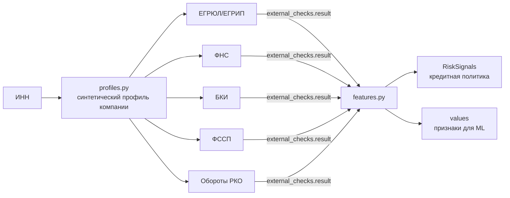

# Внешние источники (моки) и признаки заёмщика

По условиям кейса внешние системы заменены локальными моками на синтетических данных, без сетевых вызовов. Код:

- `backend/app/integrations/` — моки источников;
- `backend/app/services/features.py` — признаки;
- `backend/app/services/enrichment.py` — сбор данных по заявке.

## Как устроено

- **Профиль детерминирован по ИНН:** один и тот же ИНН всегда даёт одну и ту же компанию. Все источники показывают одну и ту же «правду» с разных сторон, поэтому выручка в ФНС согласуется с оборотами по счёту, а кредиты в БКИ — с долговой нагрузкой. ИНН из 12 цифр — ИП, из 10 — ООО.
- **Любой ИНН, кроме демо, — здоровая компания:** параметры случайные, но стабильные. Демо-ИНН из таблицы ниже включают конкретные сценарии кредитной политики.
- **`collect_external_data` опрашивает источники параллельно** и сохраняет каждый ответ в `external_checks` (сырой JSON в `result`). Если источник не ответил, проверка сохраняется со статусом `failed`, а сбор не прерывается.
- **`build_features` собирает признаки** из последних успешных ответов. Признаки неответившего источника не подставляются, источник попадает в `missing_sources`. Что делать без него, решает конвейер.
- **`GET /companies/lookup?inn=`** предзаполняет реквизиты и учредителей из мока ЕГРЮЛ.

## Источники

| Источник | Что отдаёт |
|---|---|
| ЕГРЮЛ/ЕГРИП (`egrul`) | Реквизиты, ОКВЭД, дата регистрации, статус (`active` / `bankruptcy`), руководитель, учредители. Для простоты здесь же отдаётся совпадение учредителя с санкционными списками |
| ФНС (`fns`) | Выручка и налоги за прошлый год, налоговая задолженность, среднесписочная численность, приостановления операций (`115-fz` / `tax`), массовый адрес и массовый руководитель |
| БКИ (`bki`) | Балл по шкале 1–999, действующие кредиты (остаток, платёж, просрочка), просрочки 30+ за 12 месяцев, максимальная просрочка за 24 месяца, запросы за 30 дней, отказы за 90 дней |
| ФССП (`fssp`) | Открытые исполнительные производства |
| Обороты РКО (`bank_turnover`) | Поступления и списания по счёту за 12 полных месяцев |

Цифровой профиль предпринимателя пока не моделируется: его данные дублируют ФНС и ЕГРЮЛ.

## Демо-ИНН

| ИНН | Сценарий |
|---|---|
| `7701000001` | Здоровая компания, зелёная зона |
| `7701000002` | Банкротство: стоп-фактор |
| `7701000003` | Счета заблокированы по 115-ФЗ: стоп-фактор |
| `7701000004` | Учредитель в санкционном списке: стоп-фактор |
| `7701000005` | Массовый адрес и массовый директор: стоп-фактор |
| `7701000006` | Нет сотрудников и налоговой активности: стоп-фактор |
| `7701000007` | Отрицательный Cash Flow 4 месяца подряд: стоп-фактор |
| `7701000008` | Бизнесу 7 месяцев: эскалация аналитику |
| `7701000009` | Слабая кредитная история: эскалация и риск-надбавка |
| `7701000010` | Падение выручки на 25%: риск-надбавка |
| `7701000011` | БКИ не отвечает |
| `7701000012` | Запрещённая деятельность (азартные игры): стоп-фактор |
| `7701000013` | Крупный действующий кредит: высокая долговая нагрузка |
| `7701000014` | Налоговая задолженность и исполнительные производства |
| `7701000099` | Компании нет в ЕГРЮЛ |
| `770100000001` | ИП, здоровый бизнес |

## Признаки

### Для кредитной политики (`RiskSignals`)

| Сигнал | Откуда |
|---|---|
| Стоп-фактор `bankruptcy` | ЕГРЮЛ: статус `bankruptcy` |
| Стоп-фактор `sanctioned_owner` | ЕГРЮЛ: совпадение учредителя с санкционными списками |
| Стоп-фактор `prohibited_activity` | ЕГРЮЛ: ОКВЭД `92.*` (азартные игры) |
| Стоп-фактор `accounts_blocked_115fz` | ФНС: приостановление по 115-ФЗ |
| Стоп-фактор `mass_address` / `mass_director` | ФНС |
| Стоп-фактор `no_employees` | ФНС: среднесписочная численность 0 |
| Стоп-фактор `no_tax_activity` | ФНС: налоги за год 0 |
| `business_age_months` | ЕГРЮЛ: дата регистрации |
| `weak_credit_history` | БКИ: балл < 600, или просрочки 30+ за 12 месяцев, или текущая просрочка, или 3+ отказа за 90 дней |
| `negative_cash_flow_months` | Обороты: самая длинная серия месяцев подряд со списаниями больше поступлений |
| `revenue_drop` | Обороты: поступления за последние 6 месяцев к предыдущим 6 |
| `conflicting_data` | Расхождение больше 30%: выручка в анкете и в ФНС; платежи по кредитам в анкете и в БКИ. Также обороты по счёту больше выручки в ФНС более чем на 30% (обратное нормально: у компании бывают счета в других банках) |

`existing_annual_debt_service` — годовые платежи по действующим кредитам из БКИ, вход для DSCR и Debt Burden.

`model_confidence` — это выход ML-модели, а не признак из источников. Его выставляет скоринг.

### Для ML (`Features.values`)

Плоский словарь, значения — числа, строки, bool:

- ЕГРЮЛ: `legal_form`, `okved_main`, `region`, `business_age_months`, `egrul_status`, `founders_count`, `has_sanctioned_founder`, `prohibited_activity`;
- ФНС: `fns_revenue`, `fns_taxes_paid`, `fns_tax_debt`, `fns_average_headcount`, `blocked_115fz`, `blocked_by_tax`, `mass_address`, `mass_director`;
- БКИ: `bki_score`, `bki_active_loans`, `bki_total_debt`, `bki_monthly_payments`, `bki_current_overdue`, `bki_overdue_30_plus_12m`, `bki_max_overdue_days_24m`, `bki_inquiries_30d`, `bki_refusals_90d`, `weak_credit_history`;
- ФССП: `fssp_open_proceedings`, `fssp_total_amount`;
- обороты: `turnover_inflow_12m`, `turnover_avg_monthly_inflow`, `turnover_net_cash_flow_12m`, `negative_cash_flow_months`, `revenue_drop_6m`;
- `conflicting_data`.

Список ML-признаков от команды ML пока не согласован. Сейчас здесь всё, что нужно кредитной политике, плюс сырые показатели источников. Новые признаки добавляются в `features.py`, моки менять не нужно.

## Допущения

Пороги, которых нет в кредитной политике на доске:

- слабая кредитная история — балл БКИ < 600 по шкале 1–999 или 3+ отказа за 90 дней;
- конфликт данных — расхождение больше 30%;
- запрещённая деятельность — ОКВЭД `92.*`.

Налоговая задолженность, приостановления от налоговой и исполнительные производства пока только признаки, не стоп-факторы: лимит исполнительных производств на доске не задан.
